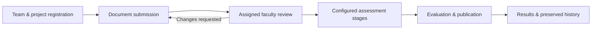

<div align="center">

# 🎓 SMART-PRO

### Academic projects, from registration to results.

**A role-based departmental platform for student projects, faculty guidance, document reviews, assessments, and accountable academic decisions.**

[](https://www.python.org/)
[](https://www.djangoproject.com/)
[](https://www.postgresql.org/)


**[Open reviewer website](https://smartpro-reviewer-25775915.onrender.com)** · **[Current evidence](docs/REQUIREMENTS_COMPLETION_REGISTER.md)** · **[Institutional readiness](docs/INSTITUTIONAL_READINESS.md)**

</div>

> [!IMPORTANT]
> **Current status — 12 November 2026:** SMART-PRO has a functioning, substantially tested academic project-management foundation. The online site is a **synthetic reviewer environment, not institutional production**. Faculty-proposed PRC/panel/final-report workflows are **not yet fully implemented**, and the concurrent PDF-upload latency target is still open. Do not use staging to approve real students, marks, or appointments.

---

## ✨ What SMART-PRO already does

| Area | Implemented and verified within the recorded test scope |
| --- | --- |
| **Student projects** | Team formation, project registration, project visibility, and scoped histories |
| **Guidance & documents** | Guide assignments, synopsis and configurable PDF submissions, reviewer feedback, revision/resubmission, immutable file versions |
| **Academic evaluation** | Configurable review stages and rubrics, evaluator assignment, individual/combined marking, stage and overall result publication |
| **Corrections & history** | Authorized corrections, preserved original releases, audit trails, and historically traceable assignments |
| **Department operations** | Admin/HOD/Coordinator authority workflows, offerings, faculty appointments, intake, search, and pagination |
| **Visibility & reminders** | Submission/evaluation summaries; approved, configurable academic deadlines and in-app reminder machinery |
| **Safety** | Role-based authorization, protected private documents, integrity checks, and independently tested local database + PDF-byte recovery |

SMART-PRO has **five core workspaces**: **Student, Faculty (Guide/Evaluator), Coordinator, HOD, and Admin**. Roles and project-specific responsibilities are not the same thing: a faculty member may be assigned to a particular project or assessment without gaining department-wide access.

### Current workflow foundation



This is the **implemented foundation**, not a claim that the new faculty-proposed PRC entry gate or presentation-panel lifecycle is already enforced.

---

## 🧭 Faculty workflow alignment — what comes next

Faculty supplied a broader flow covering **PRC, presentation panels, final report review, HOD final marks, and project closure**. Two follow-up product decisions clarify that **PRC acts before Guide allocation**, and a **PRC rejection requires a new synopsis submission**.

| Priority | Faculty-aligned capability | Status |
| --- | --- | --- |
| **P1** | PRC review **before** Guide allocation; approve / request modification / reject; fresh synopsis after rejection; preserved decision history; backend entry gate | 🔴 **Not implemented end-to-end** |
| **P2** | Coordinator-created presentation panels, Chair/members, project allocations, venue/time, panel-specific marking workspace | 🔴 **Not implemented** |
| **P3** | Dedicated final-report reviewer workflow, section checklist, Minor/Major Corrections, approval and resubmission tracking | 🟠 **Generic document-review foundation exists** |
| **P4** | Faculty-specified HOD final-marks step and explicit project closure | 🟠 **Result publication exists; specified gate/closure do not** |
| **P5** | Milestone progress updates, completion indicators, broader event alerts and project-risk dashboard | 🟠 **Basic deadlines, summaries and reminders exist** |

**Design boundaries:** Reuse current document/versioning and evaluation systems; do not rebuild them. Do not silently add PRC voting/quorum rules, panel approval layers, or new HOD restrictions. Existing HOD governance and the faculty document's narrower final-marks description need deliberate policy alignment before changing permissions. These changes are **proposed work, not shipped features**.

For the full engineering/acceptance status, see the [requirements completion register](docs/REQUIREMENTS_COMPLETION_REGISTER.md).

---

## 🧪 Verification, not just screenshots

Selected reproducible evidence from the **actual hosted reviewer** and isolated test environments:

| Check | Measured outcome |
| --- | --- |
| **Eight distinct authenticated Student actors** | 8/8 private uploads, checksum checks and submissions functionally passed in bounded hosted runs |
| **Authenticated reads (4-thread baseline)** | 480/480 successful; p95 **1.882 s** pooled across 8/16/24 sessions using the *same eight* Student identities |
| **Eight simultaneous 128 KiB PDFs** | p95 **5.641 s**, **above** the fixed 5.000 s target |
| **Eight-thread experiment** | Upload p95 worsened to **6.126 s**; read profile encountered a non-200 response; reverted to **4 threads** |
| **Independent local recovery** | PostgreSQL data/constraints/routines verified after restore; **41/41** original private PDFs copied and SHA-256 checked |
| **Accessibility sampling** | Ten signed-in mobile screens and bounded keyboard/automated checks passed; human screen-reader testing remains open |

**What this does not prove:** campus-scale load capacity, a passing eight-upload performance target, full PDF accessibility, institutionally approved academic policy, or production readiness. Earlier successful functional tests do **not** turn a measured performance failure into a pass.

**Evidence:** [four-thread run](https://github.com/10Stardust01/Smart-Pro/actions/runs/43195738956) · [eight-thread comparison](https://github.com/10Stardust01/Smart-Pro/actions/runs/43197635174) · [paired recovery](https://github.com/10Stardust01/Smart-Pro/actions/runs/43152921591) · [mobile/read checks](https://github.com/10Stardust01/Smart-Pro/actions/runs/43156630643)

---

## 👀 Reviewer website and sample data

**[Launch SMART-PRO reviewer](https://smartpro-reviewer-25775915.onrender.com)**

The reviewer website runs on **Render Free** with a **Neon Free PostgreSQL** database. Its deployment branch is `deployment/reviewer-staging`, deliberately separate from `main`; **Render auto-deploy is off**. The checked safe configuration uses **one Gunicorn worker with four threads**.

**Why do records appear right after login?** The staging reviewer accounts map to existing synthetic database identities. The browser calls backend APIs, which retrieve **already-created testing records from PostgreSQL**. This is **prepopulated test data**, not proof that every displayed value is hardcoded in JavaScript—and it is **not real faculty/student input**.

Reviewer passwords are **not** in the repository. Use your privately provided staging credentials; do not paste credentials, private PDFs, database URLs, or approval evidence into issues or commits.

---

## 🛠️ Built with

| Layer | Technology |
| --- | --- |
| UI | HTML, CSS and native JavaScript ES modules; role-specific workspaces |
| Application | Python 3.12, Django, Django REST Framework |
| Data | PostgreSQL 16 with versioned SQL migrations and permissioned routines |
| Documents | Private S3-compatible object storage; PDF validation and SHA-256 integrity |
| Testing | Python/SQL contracts, frontend tests, bounded signed-in browser/HTTPS checks |
| Reviewer deployment | Render Free + Neon Free; no paid resources or trials required |

```text
frontend/                 Role-specific browser UI
backend/smartpro/         Django APIs, authorization and domain views
proposals/curriculum/     Ordered academic schema and workflow changes
scripts/                  Local launcher, test and verification helpers
.github/workflows/        CI and controlled reviewer acceptance checks
docs/                     Technical decisions, evidence and runbooks
```

### Run a local development workspace

Start with the [deployment & recovery guide](docs/DEPLOYMENT_AND_RECOVERY.md). The local launcher requires the **existing provisioned loopback PostgreSQL 16 environment** and its private, ignored settings; it does not create PostgreSQL for you.

From the repository root in Windows PowerShell:

```powershell
# Only if the dedicated smartpro_dev workspace has NOT been initialized:
& .venv/Scripts/python.exe scripts/application.py init-development

# Regular startup — reuses existing local data:
& .venv/Scripts/python.exe scripts/application.py serve-development --port 8021 --faculty-reference
```

Open **http://127.0.0.1:8021/**. Run `init-development` only once on an unused dedicated development database. Normal startup **does not** create academic records, seed test users, apply migrations or reset a database.

For an isolated disposable browser test workspace:

```powershell
& .venv/Scripts/python.exe scripts/application.py test-workspace --port 8003
```

These launchers are **local-only**. Do not point any test reset/recreate command at the hosted Neon database, restore snapshots over staging, or treat a local synthetic persona as institutional authentication. Historical PostgreSQL prototype/test-reproduction material remains in the [deployment guide](docs/DEPLOYMENT_AND_RECOVERY.md) and source tree.

---

## 🗺️ Collaboration and next steps

1. **Align academic requirements:** PRC entry gate and rejection/resubmission, presentation panels, report reviewer and HOD-final/closure workflow—without inventing additional policy.
2. **Extend proven components:** Prefer the existing assigned-reviewer, configurable documents and criteria-wise assessment mechanisms.
3. **Finish operational acceptance:** Address hosted upload latency; then conduct representative campus workload, human accessibility, real-user usability and institutional approval checks.

**Working agreement:** No paid services or free trials, no uncontrolled stress against Render Free, no destructive changes to retained academic history, and no changes to unrelated projects.

### 📚 Documentation map

- [Requirements & evidence register](docs/REQUIREMENTS_COMPLETION_REGISTER.md) — current pass/fail boundaries and outstanding gates.
- [Course management](docs/COURSE_MANAGEMENT.md) — existing offering, stages, results and reminder model.
- [Document submission APIs](docs/DOCUMENT_SUBMISSION_API.md) — synopsis and reviewer workflow contracts.
- [Institutional readiness](docs/INSTITUTIONAL_READINESS.md) — authority, accessibility and sign-off boundaries.
- [Deployment & recovery](docs/DEPLOYMENT_AND_RECOVERY.md) — local setup, staging limits and recovery.
- [Architecture/stack review](docs/STACK_REVIEW.md) — design rationale and technical boundaries.

---

<div align="center">

**SMART-PRO** · *Project management first. Faculty-aligned workflows next.*

<sub>Reviewer pilot • Status checked 12 November 2026 • Not institutional production</sub>

</div>
